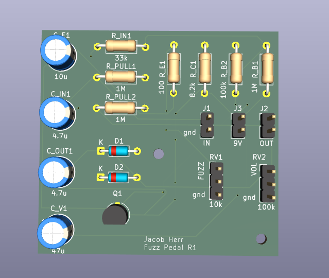
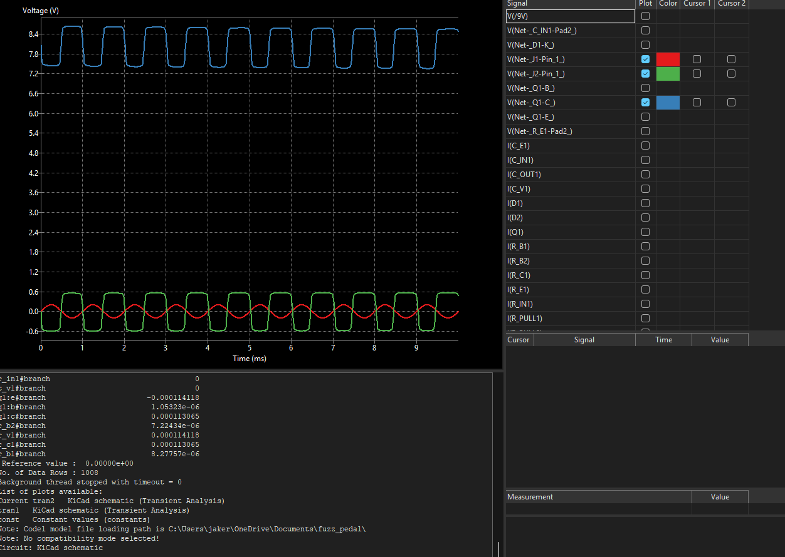
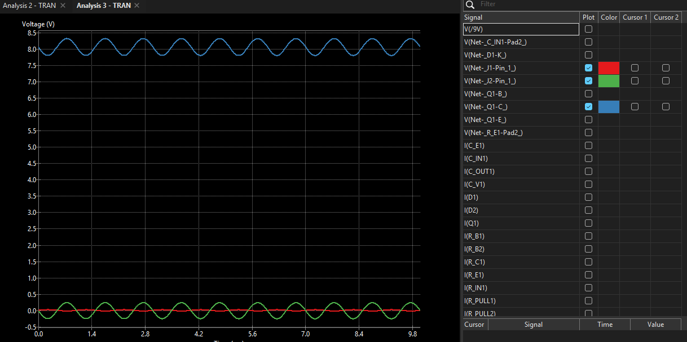
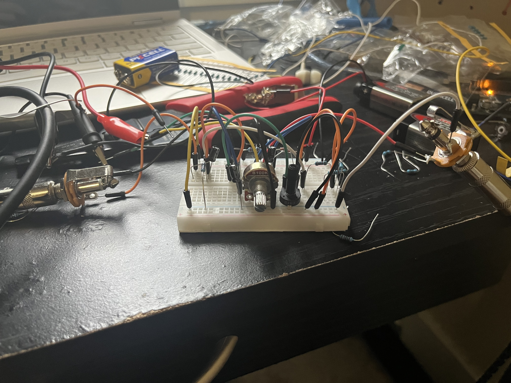
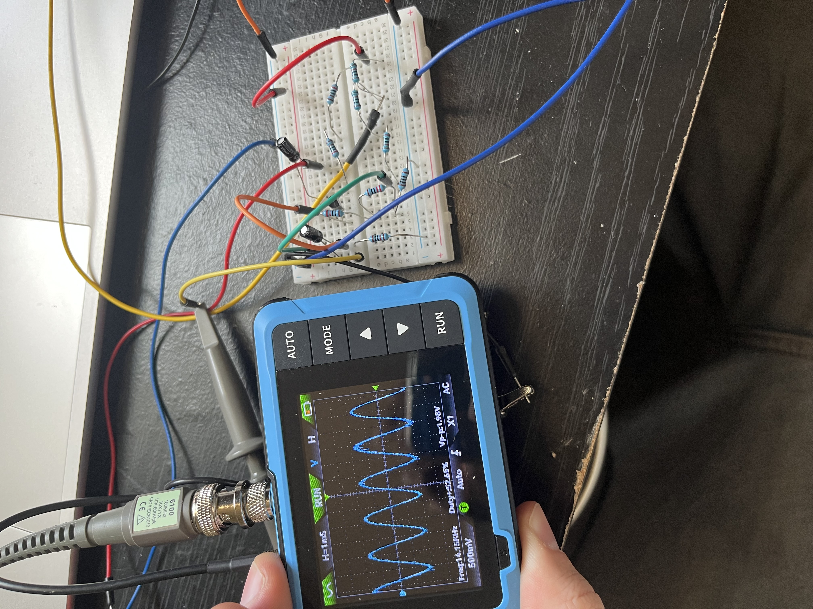
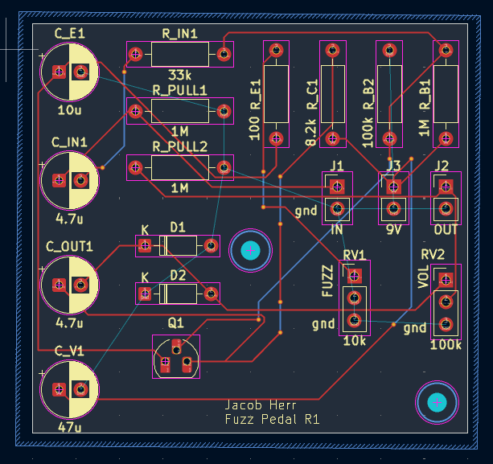

# BJT Fuzz Guitar Pedal

A single-transistor fuzz pedal with diode clipping, designed in KiCad. I prototyped the circuit on a breadboard and tested it with a digital oscilloscope, then captured the schematic and a 2-layer PCB layout and simulated the design in ngspice.



**Status:** Breadboard prototype built and tested. The PCB is designed and passes DRC, but it has **not been fabricated yet**.

## Overview

| | |
|---|---|
| Topology | Common-emitter NPN gain stage (MPSA42) with back-to-back 1N4148 clipping |
| Supply | 9V DC |
| Controls | FUZZ (10k, variable emitter resistance), VOLUME (100k) |
| Tools | KiCad 10 (schematic, PCB, ngspice), digital oscilloscope |
| Board | 2-layer PCB with pin headers for off-board jacks, pots, and battery |

## How it works

1. **Input:** a 1M pull-down sets the input DC level. C_IN1 (4.7µF) and R_IN1 (33k) couple the guitar signal to the transistor base.
2. **Gain stage:** Q1 is biased by a 1M / 100k divider (R_B1 / R_B2), with R_C1 (8.2k) as the collector load. C_E1 (10µF) bypasses the emitter for audio, so the FUZZ pot (RV1) mainly acts as an adjustable DC emitter resistance that shifts the bias point.
3. **Clipping:** C_OUT1 couples the collector signal to a pair of antiparallel 1N4148 diodes, which flatten the waveform into a near-square wave.
4. **Output:** RV2 (100k) sets the output level.

Full schematic: [`docs/fuzz_pedal_schematic_cropped.pdf`](docs/fuzz_pedal_schematic_cropped.pdf)

## Design values

| Ref | Value | Ref | Value |
|---|---|---|---|
| R_B1 | 1M | C_IN1 | 4.7µF |
| R_B2 | 100k | C_OUT1 | 4.7µF |
| R_C1 | 8.2k | C_E1 | 10µF |
| R_E1 | 100Ω | C_V1 | 47µF |
| R_IN1 | 33k | D1, D2 | 1N4148 |
| R_PULL1, R_PULL2 | 1M | Q1 | MPSA42 |
| RV1 (fuzz) | 10k | RV2 (volume) | 100k |

> These are the **design values**. The breadboard prototype was tuned by ear and its exact component values were not recorded. The schematic uses standard E-series values, with some values adjusted from the prototype.

## Simulation (ngspice in KiCad)

The simulation schematic is in [`simulation/`](simulation/). Device models are generic approximations (the transistor is a generic NPN with BF=100, not the manufacturer's MPSA42 model), so the results are approximate.

**DC operating point (RV1 branch set to 1k):**

| Node | Voltage |
|---|---|
| Base | 0.72 V |
| Emitter | 0.13 V |
| Collector | 8.07 V |
| Collector current | about 113 µA |

The transistor is in its active region with a low bias current. The collector sits close to the supply, which leaves little headroom for upward swing, so the stage clips asymmetrically before the diodes come into play.

**Transient response, 1 kHz sine input:**



At 200 mV the diode pair flattens the output into a roughly symmetric, square wave. The clipping level depends on the diode model, so the shape is not precise as to what the actual fabrication would produce.



The 20 mV run is included for comparison, showing how the response changes with input level.

## Breadboard prototype





The circuit was built and tested on a breadboard, and the oscilloscope photo shows the early prototyping/testing of the gain stage.

**Audio demo:** [`docs/pedal-demo.mp3`](docs/pedal-demo.mp3), recorded from the final breadboard prototype.

## PCB



- 2 layer board with a ground pour
- Passes DRC with zero errors and zero unrouted nets
- Through hole parts and pin headers, so it can be assembled by hand
- Not yet fabricated

## Repository layout

```
fuzz-pedal/
├── README.md
├── LICENSE
├── hardware/       KiCad project files (schematic and PCB layout)
├── simulation/     Simulation schematic and ngspice plots
├── docs/           Schematic PDF and audio demo
└── images/         PCB renders, breadboard and scope photos
```

## Lessons learned

- Simulating the design showed a low bias point (collector near the supply rail), which I would not have caught from the schematic alone.
- SPICE decides component type from the first letter of the reference designator, and a transistor model's pin order has to be mapped explicitly. A reversed collector/emitter assignment still runs without errors, and I caught it by checking the sign of the collector current.
- prototyping and wiring takes careful detail and patience, on several occasions I would quickly rewire the prototype, only to find several mistakes. Only until
I slowed down and paid attention was I able to fabricate a working prototype.

## Next steps

- Order the boards, assemble the PCB, and compare measured bias voltages with the simulation.
- Re-center the bias point and compare the waveform and sound.
- Run the simulation across the full range of the fuzz pot.
- Add reverse polarity protection on the 9V input and design for a 1590B enclosure.

## Author

Jacob Herr

## License

See [LICENSE](LICENSE).
